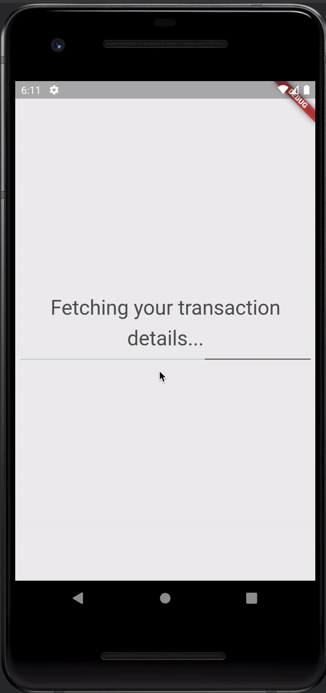

# jazzcash_flutter

Flutter package for starting JazzCash hosted payments in a WebView. Supports
JazzCash sandbox and live transaction URLs.

> **Production validation pending:** Automated analysis and tests pass, but this
> release has not been tested end-to-end with a live JazzCash merchant account.
> Validate it in your own sandbox and production environment before launch.

> **Security:** This package builds the payment form on the device and embeds
> the merchant password and integrity salt in WebView content. App binaries and
> WebView content are not secure places for merchant secrets. For production,
> create and sign payment requests on your backend, and verify every transaction
> with JazzCash on your backend before fulfilling an order. Never trust a
> client-side response alone.

## Requirements

- Dart 3.0 or later
- Flutter 3.0 or later
- A JazzCash merchant account and configured return URL

## Installation

```shell
flutter pub add jazzcash_flutter
```

Import the package:

```dart
import 'package:jazzcash_flutter/jazzcash_flutter.dart';
```

## Start a payment

Call `startPayment` from a widget callback with your merchant configuration and
the payment details. The amount is expressed in PKR; the hosted form converts it
to the minor units expected by JazzCash.

```dart
final jazzCash = JazzCashFlutter(
  merchantId: merchantId,
  merchantPassword: merchantPassword,
  integritySalt: integritySalt,
  isSandbox: true, // Use false only with live credentials and configuration.
);

final response = await jazzCash.startPayment(
  context: context,
  paymentDataModelV1: JazzCashPaymentDataModelV1(
    ppAmount: '100.00',
    ppBillReference: 'ORDER-12345', // Use a unique reference for every order.
    ppDescription: 'Order 12345',
    ppMerchantID: merchantId,
    ppPassword: merchantPassword,
    ppReturnURL: 'https://your-server.example.com/jazzcash/return',
  ),
);

if (response == null) {
  // The flow was cancelled or the response could not be read.
} else {
  // Treat this as unverified input. Confirm the transaction on your backend.
}
```

`startPayment` returns the text from the gateway's return page, or `null` if no
response could be read. The package does not verify payment status.

## Example app

See [`example/`](example/) for a runnable sandbox flow. Replace its placeholder
merchant values and return URL with values from your JazzCash sandbox account.

## Demo

| Android | iOS |
| --- | --- |
|  |  |

## License

See [LICENSE](LICENSE).
